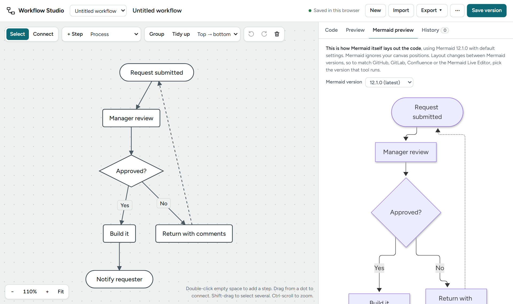

# Workflow Studio

A visual editor for [Mermaid](https://mermaid.js.org/) flowcharts that runs in your browser. Drag steps around a canvas and the Mermaid code updates. Edit the code and the canvas updates. Save named versions and compare them line by line.

No install, account or server. Your diagrams stay on your own computer.



**Try it online:** [hyunjee-hale.github.io/workflow-studio](https://hyunjee-hale.github.io/workflow-studio/), or download the repo and open `index.html` (see [Run it](#run-it)). The online version keeps its diagrams separately from copies you open from your disk.

> **Beta, built with AI.** This project was developed with Claude, and I haven't reviewed the code line by line yet. Read [DISCLAIMER.md](DISCLAIMER.md) before you rely on it.

## Why I built this

I like tools that run on my own computer, without an account, a server or, ideally, an internet connection. I wanted a simple tool for drawing workflow diagrams that I could open straight from a local HTML file, with my work saved on my own machine instead of in someone else's cloud.

Workflow Studio is that tool. Open `index.html` in a browser and start drawing. In Chrome and Edge you can save your diagrams as `.mmd` files in a folder you choose, for example a `diagrams` folder next to `index.html`. In other browsers they're saved in the browser itself. Either way, nothing leaves your computer (see [Where your diagrams are saved](#where-your-diagrams-are-saved)).

I'm also sharing it as I go. It started as a prototype I built together with AI, and I'm reviewing, fixing and improving it in the open instead of waiting until it's finished. Along with the tool, I'm sharing my process (how I work with AI, what the reviews found and what changed as a result) as a record of learning and growing my development skills with AI. [DISCLAIMER.md](DISCLAIMER.md) has the details and what's next.

Out of the box, the page loads these from the internet:

| What | Used for | Loaded from |
|---|---|---|
| Mermaid 12.1.0 | Mermaid preview, Mermaid image export, non-flowchart diagrams | jsDelivr (`cdn.jsdelivr.net`) |
| Dagre 0.8.5 | **Tidy up** (automatic layout) | cdnjs (`cdnjs.cloudflare.com`) |
| Figtree and JetBrains Mono fonts | Interface and code text | Google Fonts (`fonts.googleapis.com`, `fonts.gstatic.com`) |
| Other Mermaid versions (only if you pick one) | Mermaid preview in that version | jsDelivr |

To run fully offline, download the two library files into a `lib/` folder once (see [Working offline](#working-offline)). When you open `index.html` as a file, the page then loads them from `lib/` and doesn't contact the CDNs. The fonts still come from Google Fonts when you're online; without the internet they quietly fall back to your system fonts. To stop the page asking Google Fonts at all, set `fonts: false` (see [Settings](#settings-optional)). With `lib/` filled in and `fonts: false`, the page makes no internet requests.

## Run it

Open `index.html` in a current desktop browser. It has been tested in Chrome (Chromium). It should work in current Edge, Firefox and Safari, but those haven't been tested yet. Folder saving needs Chrome or Edge (see [Where your diagrams are saved](#where-your-diagrams-are-saved)).

To serve it from a web server instead, copy these three files into one folder:

```
index.html
workflow-studio.css
workflow-studio.js
```

### Using the online version

The [online version](https://hyunjee-hale.github.io/workflow-studio/) is the same app, served by GitHub Pages. GitHub only sends the app's files: your diagrams never leave your computer, and nobody else (including me) can see them.

- **Diagrams are saved in your browser on this device**, for the site `hyunjee-hale.github.io`. They stay between visits, but another browser or computer won't see them. They're also separate from any copy you open from your disk.
- **Clearing this site's data in your browser deletes them**, and a private or Incognito window discards them when you close it.
- **For anything you want to keep,** download a backup with **⋯ → Download all diagrams (.json)**, or, in Chrome or Edge, use **⋯ → Save diagrams to a folder…** so each diagram is saved as a `.mmd` file on your computer.

### Working offline

The page loads two libraries from public CDNs: Dagre (automatic layout) and Mermaid (preview and image export). To work without internet access, download them into a `lib/` folder next to `index.html`:

```
lib/dagre.min.js     https://cdnjs.cloudflare.com/ajax/libs/dagre/0.8.5/dagre.min.js
lib/mermaid.min.js   https://cdn.jsdelivr.net/npm/mermaid@12.1.0/dist/mermaid.min.js
```

You can open each link in a browser and save it into `lib/` with that exact name, or run the commands below from the folder that contains `index.html`.

Windows (PowerShell):

```powershell
New-Item -ItemType Directory -Force lib | Out-Null
Invoke-WebRequest https://cdnjs.cloudflare.com/ajax/libs/dagre/0.8.5/dagre.min.js -OutFile lib\dagre.min.js
Invoke-WebRequest https://cdn.jsdelivr.net/npm/mermaid@12.1.0/dist/mermaid.min.js -OutFile lib\mermaid.min.js
```

In PowerShell, `curl` is a shortcut for `Invoke-WebRequest` and doesn't accept curl's options. If you prefer curl, type `curl.exe`.

macOS or Linux (Terminal):

```bash
mkdir -p lib
curl -L -o lib/dagre.min.js https://cdnjs.cloudflare.com/ajax/libs/dagre/0.8.5/dagre.min.js
curl -L -o lib/mermaid.min.js https://cdn.jsdelivr.net/npm/mermaid@12.1.0/dist/mermaid.min.js
```

The files are about 0.3 MB and 5.5 MB.

Opened as a file, the page looks in `lib/` first and only uses the CDN for files that aren't there. Served from a web server, it tries the CDN first and falls back to `lib/` (set `localFirst: true` to change that). Offline, the Mermaid preview can only use versions you have saved locally. `lib/mermaid.min.js` covers the default (12.1.0). To keep other versions offline too, save each one as `lib/mermaid-<version>.min.js`, for example `lib/mermaid-11.4.1.min.js` from `https://cdn.jsdelivr.net/npm/mermaid@11.4.1/dist/mermaid.min.js`. Without Dagre, **Tidy up** uses a simpler built-in layout: steps in rows (or columns, for left-to-right diagrams) in the order they connect. Without Mermaid, the Mermaid preview tab and Mermaid image export are unavailable, but canvas editing, the Preview tab and canvas image export still work.

## Using it

| To | Do this |
|---|---|
| Add a step | Double-click empty canvas, press **N**, or use **+ Step** |
| Connect two steps | Drag from a dot on a step's edge to another step, or switch to **Connect** (**C**) |
| Rename anything | Double-click it, or select it and press **Enter** |
| Select several | Shift-drag a box, or Shift-click |
| Group into a subgraph | Select steps, then **Group** (**G**) |
| Lay out automatically | **Tidy up** (**L**) |
| Undo / redo | **Ctrl+Z** / **Ctrl+Shift+Z** |
| Zoom / pan | Ctrl-scroll to zoom; drag empty canvas or scroll to pan |
| Edit the code directly | **Code** tab; the canvas follows as you type |
| See your layout as a clean picture | **Preview** tab |
| See Mermaid's own layout, as another tool will draw it | **Mermaid preview** tab; pick that tool's Mermaid version |
| Mark a point in history | **Save version**; compare or restore it from **History** |
| Bring in existing Mermaid | **Import** (paste, or open `.mmd`, `.md` or `.txt`) |
| Get it out | **Export**: copy the Mermaid code, or download `.md` or `.txt`, a canvas image (`.svg` or `.png`) or Mermaid's image (`.svg`) |

Diagrams that aren't flowcharts (sequence, Gantt and so on) open as code with a live preview. Versions and export still work for them.

## Where your diagrams are saved

There are two places, depending on your browser:

| Browser | Where diagrams are saved |
|---|---|
| **Chrome, Edge** (desktop) | **A folder you choose**, as `.mmd` files. Until you choose one, in the browser. |
| **Firefox, Safari**, and browsers that turn off folder access (Brave may, by default) | In the browser only. These browsers don't let web pages write to folders on your computer. |

Folder saving relies on the browser's File System Access API, which only Chromium-based desktop browsers support. The studio checks for it and only shows **Save diagrams to a folder…** where it works.

### Saving to a folder (Chrome, Edge)

1. Make a folder for your diagrams, for example `diagrams` next to `index.html`.
2. Open **⋯ → Save diagrams to a folder…** and pick it. The browser asks you to allow editing files in it.
3. If you already have diagrams in the browser, the studio offers to copy them, with their versions, into the folder. The browser copies stay where they are.

After that, every change saves straight to the folder:

```
diagrams/
  Approval flow.mmd        <- one file per diagram: its Mermaid code, plus the %% @layout line
  Onboarding.mmd
  workflow-studio.json     <- names, dates and saved versions (keep it with the .mmd files)
```

- **The `.mmd` files are ordinary Mermaid files.** Open them in any Mermaid tool, put them in git, or edit them in another editor. Edits made elsewhere show up when you switch back to the studio's tab. A `.mmd` file you add to the folder by hand appears as a new diagram.
- **Editing in the studio rewrites the file in its standard layout** and adds the `%% @layout` line. Files you don't touch in the studio are left exactly as they are.
- **Renaming a diagram renames its file. Deleting a diagram deletes its file.** A rename that only changes capital letters keeps the existing file name, because Windows and macOS treat them as the same file.
- **If a file changes outside the studio while you're editing it,** for example in another tab or editor, the studio doesn't overwrite it. It asks whether to **Keep mine** or **Load the other version**; Undo brings your edits back if you load the other one.
- **Two tabs on the same folder** keep each other's diagrams and saved versions. Switching back to a tab reloads anything that changed. One exception: don't rename a diagram in one tab while it's open with unsaved edits in another, because the other tab can save it again under its old file name.
- **Saved versions live in `workflow-studio.json`, matched by file name.** Renaming a `.mmd` in File Explorer or Finder makes it look like a new diagram without its versions; rename diagrams inside the studio instead. If `workflow-studio.json` gets damaged, the studio keeps a copy (`workflow-studio.damaged-<date>.json`) and tells you, rather than overwriting it.
- **The browser may ask permission again** each time you reopen the page. You'll see a **Reopen your diagrams folder** button. Recent versions of Chrome and Edge also offer "Allow on every visit".
- The browser remembers which folder you chose, not the folder's location on disk. Moving or renaming the folder means choosing it again.
- **In Chrome and Edge, copies of the studio opened from your disk share this memory.** These browsers treat every local HTML file as the same site for storage, so a second copy (say, a backup folder) reopens the same save folder and sees the same browser-saved diagrams. Separate storage per copy is on the list in [DISCLAIMER.md](DISCLAIMER.md).
- **⋯ → Change save folder…** switches folders. **⋯ → Stop saving to the folder** goes back to browser storage; your files stay in the folder.

### Saving in the browser (all browsers)

Diagrams are kept in the browser's local storage, on this device only. That means:

- Another browser or computer won't see them.
- Clearing site data, or browsing in a private window, removes them.

### Backups and moving diagrams (all browsers)

**⋯ → Download all diagrams (.json)** saves every diagram and its version history in one file. **⋯ → Load diagrams from a .json file…** adds them back, in any browser and in either storage mode. With folder saving, the folder itself is also your backup: copy it like any other folder.

## Your layout vs. Mermaid's layout

There are two pictures of every diagram. Knowing which one you're looking at saves surprises.

| | **Preview** tab | **Mermaid preview** tab |
|---|---|---|
| Shows | Your layout, exactly as you arranged it on the canvas | How Mermaid itself lays out the code |
| Uses | Your positions (only this editor knows them) | The Mermaid version you pick (12.1.0 by default), with default settings |
| Save it as | **Export → Download canvas image** (`.svg` or `.png`) | **Export → Download Mermaid image** (`.svg`), or copy the code |

**Why they differ:** Mermaid code describes *what* is connected, not *where* things sit. Every tool that renders Mermaid works out its own layout each time. Mermaid has no way to pin a step to a position, so a layout you drag into shape here can't travel inside the code.

**Other tools can differ again, mostly because of the Mermaid version.** Mermaid's layout changed noticeably in version 12. For example, connections became right-angled, and loops get arranged differently. GitHub, GitLab, Confluence and the Mermaid Live Editor each upgrade on their own schedule, so the same code can come out arranged differently in each.

To see what a particular tool will draw, pick its version in the **Mermaid version** menu on the Mermaid preview tab:

| Version in the menu | Use it for |
|---|---|
| 12.1.0 (latest, default) | The Mermaid Live Editor (it shows its version in its menu) |
| 11.17.2 | The last 11.x release |
| 11.4.1 | A widely used 11.x release, for comparison |
| 10.9.4 | The last 10.x release; some self-hosted tools still run 10 |
| Other version… | Type any version from [npm](https://www.npmjs.com/package/mermaid?activeTab=versions) |

Your choice is remembered in this browser. It also applies to **Export → Download Mermaid image**. Themes (for example the Live Editor's `redux-dark-color`) only change colours, not layout. The studio uses Mermaid's plain light or dark theme. A tool can also change the layout engine (for example `layout: elk`) in its own settings.

The studio remembers your positions by adding a comment line to the code:

```
%% @layout {"start":[120,80],"step1":[120,200]}
```

Mermaid ignores comments, so the code still renders anywhere. Paste it back into Workflow Studio and your layout returns. Paste it into another tool and that tool lays it out its own way.

**To share your exact layout,** export a canvas image. It uses the current light or dark theme. The `.png` uses your system font, so text may look slightly different from the editor.

**To make Mermaid's own layout closer to what you want,** edit the code. These survive editing in the studio:
- Change the direction: `flowchart LR` versus `TD`, or `direction LR` inside a subgraph.
- Group steps in subgraphs to keep them together.

These work in Mermaid, but the studio undoes or moves them whenever it rewrites the code, which it does when you edit on the canvas, import, or leave the Code tab after typing. Add them last, in the tool you publish to:
- Reorder lines: Mermaid roughly follows the order steps and links are written. The studio always writes steps first, then subgraphs, then connections.
- Make a link longer with extra dashes (`A ---> B`) to push a step further down. The studio writes it back as `A --> B`.
- Use an invisible link (`A ~~~ B`) to place two steps near each other without a line. The studio keeps it, but moves it to the end of the code.
- Try the ELK layout engine (supported by the Mermaid Live Editor, but not by every site) by adding this to the very top:
  ```
  ---
  config:
    layout: elk
  ---
  ```

## Settings (optional)

Add this before the `workflow-studio.js` script tag in `index.html`:

```html
<script>window.WFS_CONFIG = { theme: 'light', fonts: false };</script>
```

| Key | Default | Meaning |
|---|---|---|
| `theme` | follows the OS | `'light'` or `'dark'` |
| `storageKey` | `'wfs-local'` | local-storage key for browser-saved diagrams. It doesn't separate the remembered save folder or other settings, so it isn't a fully separate workspace (see [DISCLAIMER.md](DISCLAIMER.md), What's next) |
| `mermaidVersion` | `'12.1.0'` | Mermaid version used until someone picks another |
| `mermaidVersions` | 12.1.0, 11.17.2, 11.4.1, 10.9.4 | versions listed in the Mermaid version menu |
| `mermaidUrl` | jsDelivr | where to load Mermaid from; `{v}` is replaced by the version |
| `localFirst` | `true` when opened as a file | try `lib/` before the CDN |
| `libs` | `lib/` copy and CDN | where to load Dagre and the default Mermaid version from, e.g. `{ dagre: ['js/dagre.min.js'] }`; keys you leave out keep their defaults |
| `fonts` | `true` | `false` skips loading Figtree / JetBrains Mono from Google Fonts |

## Files

| File | What it is |
|---|---|
| `index.html` | The page and the studio's markup |
| `workflow-studio.css` | Styles. Scoped under `#wfs-root`, with every class prefixed `wfs-`. |
| `workflow-studio.js` | The app |
| `docs/screenshot.png` | The image above |
| `.prettierrc.json` | Code formatting settings for [Prettier](https://prettier.io/), used when editing the JS and CSS |
| `diagrams/` (you create it) | Suggested folder for your `.mmd` files when saving to a folder |

## More

- [RUNBOOK.md](RUNBOOK.md): how the code works, how to change it and how to test it
- [DISCLAIMER.md](DISCLAIMER.md): how this was made, review status and what's next
- [THIRD_PARTY_NOTICES.md](THIRD_PARTY_NOTICES.md): libraries and fonts, and their licenses

## License

[MIT](LICENSE). The libraries and fonts it loads have their own licenses; see [THIRD_PARTY_NOTICES.md](THIRD_PARTY_NOTICES.md).

## Privacy

The studio has no analytics or tracking, and it doesn't upload your diagrams anywhere. Unless you've set it up to run offline, the browser downloads the libraries from cdnjs and jsDelivr and the fonts from Google Fonts, and those services can see your IP address. To avoid that, fill in `lib/` (see [Working offline](#working-offline)) and set `fonts: false`.

**Other local files can see your studio data.** In Chrome and Edge, any HTML file you open from your disk shares the same browser storage. Another local page could read your browser-saved diagrams and the remembered save folder, and if you chose "Allow on every visit" it may be able to reach that folder too. Only open local HTML files you trust. Or serve the studio from a web address instead of opening it from disk, for example with GitHub Pages or a local web server; it then gets its own storage that other local files can't reach.
